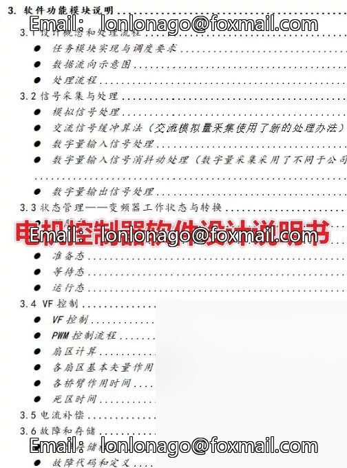
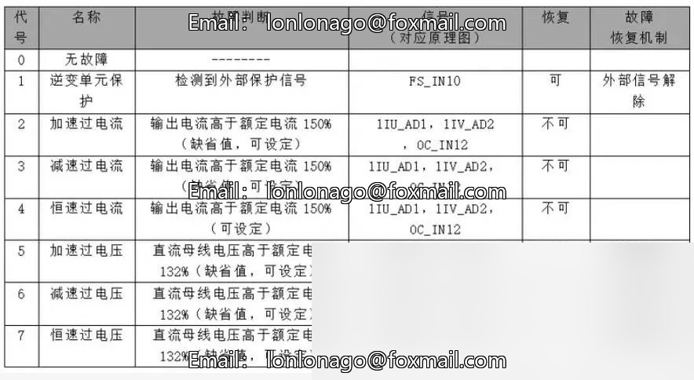
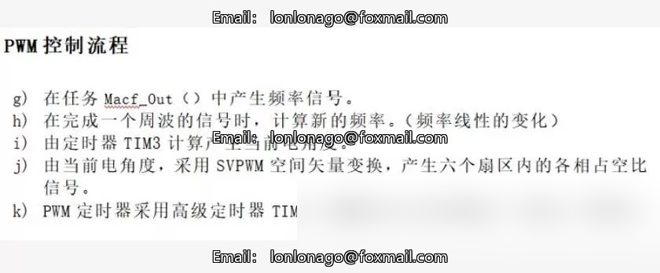

# Software design specification for motor controller

## Body

Motor controller software design manual
disk shipment, can be scanned directly for payment.

The manual covers software module descriptions, design concepts and processing flows, task implementation and scheduling, signal collection and processing, state management, PWM control procedures and current compensation.

<!-- AI_ENRICHED -->

## Images

## Payment

Here is a pay link on Stripe ( https://buy.stripe.com/3cs8yP7sY87d0vu9AB ). Please contact me lonlonago@foxmail.com after funding $89, and I will send you a complete data files , thank you!

